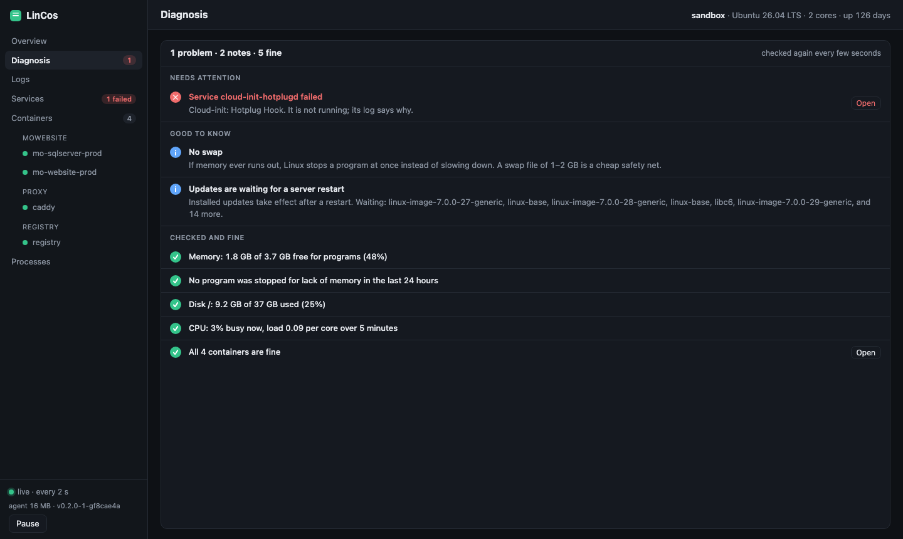

# LinCos

A tiny monitor for your Linux server (about 15 MB of memory). It runs on the
server and you open it from your computer through SSH. One page shows the
memory, CPU and logs of every container, service and program, plus each
container's files and database.


## Install

Download the installer, read it, then run it. It installs only files whose
SHA-256 matches the release's `SHA256SUMS`.

```bash
# On the Linux server
curl -fsSLO https://raw.githubusercontent.com/ravaee/Mo.LinCos/main/install/server.sh
less server.sh
sudo sh server.sh

# On your Mac or Linux computer
curl -fsSLO https://raw.githubusercontent.com/ravaee/Mo.LinCos/main/install/local.sh
less local.sh
sh local.sh
```

Windows (PowerShell):

```powershell
irm https://raw.githubusercontent.com/ravaee/Mo.LinCos/main/install/local.ps1 -OutFile local.ps1
notepad local.ps1
powershell -ExecutionPolicy Bypass -File local.ps1
```

Run the same installer again to update.

### Or check a binary yourself

Every release file is built by GitHub Actions from this repo and signed with a
[build attestation](https://docs.github.com/actions/security-for-github-actions/using-artifact-attestations).
To check one yourself, download it and `SHA256SUMS` from the
[latest release](https://github.com/ravaee/Mo.LinCos/releases/latest), then:

```bash
gh attestation verify lincos-linux-amd64 --repo ravaee/Mo.LinCos   # built here, from this repo
sha256sum --check --ignore-missing SHA256SUMS                       # not changed since
```

## Use

```bash
lincos open <ssh-host>
```

It opens the page in your browser through an SSH tunnel. Ctrl+C closes it.
The agent only listens on 127.0.0.1, so your SSH login is the only way in.
Deleting files or changing data always asks first.

| Services and their logs | Diagnosis |
|---|---|
|  |  |

MIT licensed.
