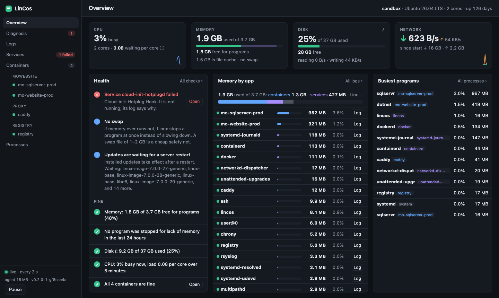
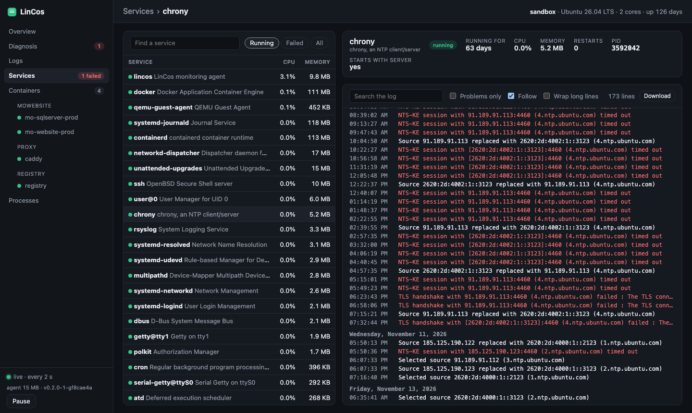

# LinCos

A tiny monitor for your Linux server (about 15 MB of memory). It runs on the
server and you open it from your computer through SSH. One page shows the
memory, CPU and logs of every container, service and program, plus each
container's files and database.



## Install

```bash
# On the Linux server
curl -fsSL https://raw.githubusercontent.com/ravaee/Mo.LinCos/main/install/server.sh | sudo sh

# On your Mac or Linux computer
curl -fsSL https://raw.githubusercontent.com/ravaee/Mo.LinCos/main/install/local.sh | sh
```

Windows (PowerShell): `irm https://raw.githubusercontent.com/ravaee/Mo.LinCos/main/install/local.ps1 | iex`

## Use

```bash
lincos open <ssh-host>
```

It opens the page in your browser through an SSH tunnel. Ctrl+C closes it.
The agent only listens on 127.0.0.1, so your SSH login is the only way in.
Deleting files or changing data always asks first.

| Services and their logs | Diagnosis |
|---|---|
|  |  |

MIT licensed.
